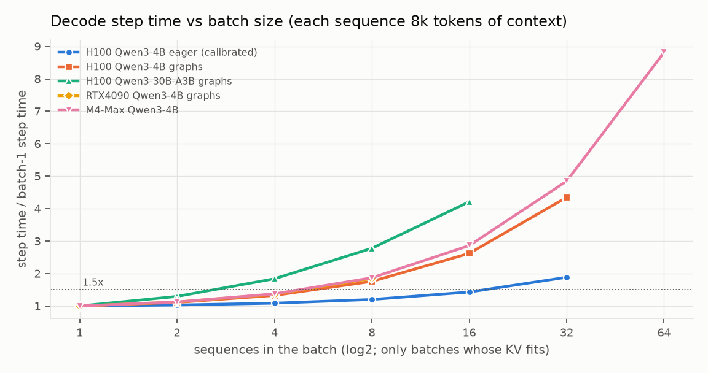
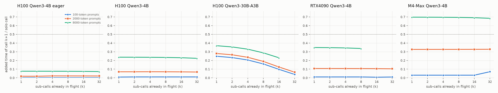
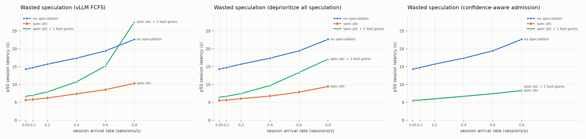
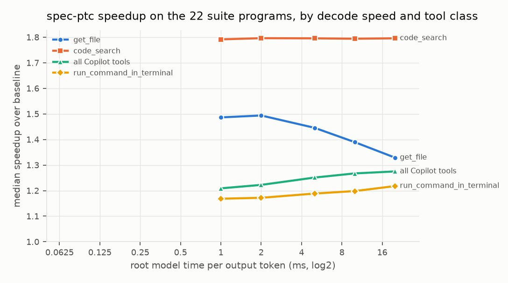

# Speculative tool calling on a shared model server: does it clog, and when are sub-calls free?

October 19, 2026 · GPU-free replay simulator · code, data and every table in this repository
· corrected October 20 ([Correction](#correction-october-20-the-simulators-kv-cache): some headlines moved when the simulator's KV
cache was made to follow vLLM 0.32; the original text is kept and marked)

*This is the research appendix: the simulation study behind the plugin's design. The
project's front page is [README.md](../README.md), with the measured results from three
T4 runs. Their records are under `results/`: the
[first](../results/kaggle_t4/RESULTS.md), the
[second](../results/kaggle_t4_v3/RESULTS.md) and the
[third, under KV pressure](../results/kaggle_t4_v4/RESULTS.md). The plugin's rules are in
[integrations/README.md](../integrations/README.md).*

## Summary

Code-mode speculation (sPTC) starts an agent's tool calls while the root model is still
writing the program. ~~Published measurements so far look only at the agent.~~
*(Corrected October 20: not so. SPAgent, Nichols et al., PASTE v3 and SPORK all touch the
serving side; see [docs/related_work.md](related_work.md).)* This
simulator also models the server: the root model's decode and every sub-call share one
vLLM-V1-style continuous-batching engine. That makes it possible to measure what
speculation does to the server.

**Q1. Does speculation clog the server? Correct speculation does not; wasted
speculation does.**

- Correct speculation: spec-ptc lowered p50 and p99 session latency at every load,
  on every server tested. Calls issued together get batched instead of being decoded one
  at a time. The cost lands on other agents' root streams: their TPOT p99 rises 8–79%
  under vLLM's default FCFS.
- Wasted speculation clogs. With one wrong guess per real speculation under FCFS,
  the gain shrinks as load rises and turns into a loss near saturation:
  - p50 **1.22×** the no-speculation baseline on an H100 with CUDA graphs at 0.8
    sessions/s *(corrected: 1.30×; holds)*;
  - ~~**1.47×** on an RTX 4090 at its highest load~~ *(corrected: 1.01× at that load,
    0.14/s, which is break-even, not a loss; a steady-state loss appears only at 0.15/s,
    1.41×, where the server is at capacity)*;
  - 1.18× at 0.6 sessions/s on an H100 when the model already batches its own
    fan-out (1.43× at 0.8/s, but that run was not in steady state) *(corrected: 1.20× and
    1.46×; holds)*.

  Corrected values and why they moved: [Correction (October 20)](#correction-october-20-the-simulators-kv-cache).
  On the MoE server it never became a net loss (0.66–0.74×; 0.4/s re-run: 0.68×). In real agent code, bad
  guesses are 35–500× rarer than this stress setting (see the update below).

**What fixes it is admission control, not ordering.** *(This is consistent with
co-location work that serves best-effort work from leftover capacity: HyGen, Echo,
ConServe, BROS, Niyama. It is not a new insight, and those papers are not claimed to have
compared admission with ordering; Niyama's own mechanism, per-iteration relegation, is an
ordering policy. See [docs/related_work.md](related_work.md).)*
*(Measured October 29, under KV pressure
([results/kaggle_t4_v4/RESULTS.md](../results/kaggle_t4_v4/RESULTS.md)), which qualifies
this:*
- *A client-side cap did as well as the plugin (0.982 / 1.000).*
- *With bets that are needed half the time, refusing them made sessions 1.5× slower than
  admitting them all, while vLLM priority, which only makes them wait, was 1.65× faster
  than the plugin.*
- *So admission control pays against worthless bets. For bets that may be needed, waiting
  beats refusing.)*

- Ordering does nothing. Continuous batching admits all the work at once, so
  clogging shows up as slower steps for everyone, not as a queue to reorder.
  *(Measured October 20: vLLM priority scheduling was 0.989–1.011 of FCFS on the T4, and
  nothing waited. See
  [results/kaggle_t4_v3/RESULTS.md](../results/kaggle_t4_v3/RESULTS.md).)*
- What works is a scheduler that separates bets from certain work:
  - Almost every early call in code mode is *certain*. The shadow issues it from a
    finished statement and the real run will claim it.
  - Only branch arms, literal launches and predictions are bets.
  - Bets are admitted only inside the decode free-ride window (Q2) and dropped
    otherwise.
  - Certain early calls get a small per-step prefill allowance.
- Result: with one bad guess per call at 0.8 sessions/s on the calibrated H100,
  p50 is 0.36× the baseline, against 0.97× under FCFS. With 40% of bet labels wrong it
  is still 0.63×. *(Corrected: 0.36× vs 0.96×, and 0.66× with 40% wrong; holds. In this
  simulated policy a bet is gated when submitted, while its paired real call still waits,
  so it is mostly the "no normal work waiting" rule that refuses decoys; see the
  Correction.)*

**Q2. Do extra sub-calls ride along free? Their decode does; their prefill doesn't; on
MoE nothing is free until the experts are saturated.**

- Decode, dense models. On an H100 decoding Qwen3-4B with CUDA graphs, a decode
  step stays under 1.5× the batch-1 step up to 32 sequences at 1k context, 8 at 8k and
  4 at 32k.
- Prefill. One 2,048-token sub-call prompt in the same step makes the root's next
  token 7.2× slower on an H100 and 15× slower on an RTX 4090.
- MoE. On Qwen3-30B-A3B the step reaches 1.5× at only 4 sequences, because each
  extra token pulls in experts nobody else needed. Even a 256-token prefill touches
  nearly all 128 experts: that step is 4.8× slower. So the 2nd to 8th parallel sub-call
  each add 16–25% of a solo call. That marginal cost falls to 4% only once about 32
  calls have loaded every expert. The free window is inverted compared with dense models.

**Validation.**

| What | Result |
|---|---|
| Agent side vs real spec-ptc | Within 1.2% on all 44 suite pattern×mode cells |
| Full model vs spec-ptc's committed vLLM results (`runs.csv`) | Leave-one-out median error 2.3%; 5.2% on the 13 server-sensitive patterns |
| Step-cost model vs NVIDIA's Llama-3.1-8B H100 ITL table | Within 6.5% at every concurrency (5 points, 2 overheads fit) |
| Step-cost model vs a published Qwen3-30B-A3B vLLM point | Predicted within 6.5% (1 overhead fit on a different point) |

**Review.** A review before the report raised 40 issues in this code, and 22 of them held
up on re-examination. All are fixed or stated as limits in §6, and every number here comes
from the post-fix rerun. The audit of October 20 came later and is separate
([Correction](#correction-october-20-the-simulators-kv-cache)).

### Update: first checks against real agent code

Details: `results/census/SUMMARY.md`. A second review corrected this section's first
draft.

1. Agent code produces almost no bets. The corpora are 64,546 tool calls from CodeAct
   (2023 models) and smolagents traces (2025 models).
   - Among safely speculable reads, a literal-only speculator would launch 0–0.2% bets on
     web research and 2.8% on ALFWorld's `look()`.
   - spec-ptc launches no branch bets.
   - The call is usually written near the end of the message: a median of 3–9 tokens
     follow it.
   - Only 2–14% of web-research blocks have two or more parallel candidates.

   §4.2's stress setting (one bad guess per call) is about 35× to more than 100× above
   these rates. Waste-driven clogging is a risk for *prediction-based* speculation, not for
   code-mode speculation on these workloads.

   A tiny RLM sample (13 sub-calls, gpt-5-nano) has the opposite shape: fan-out (71% of
   blocks hold two or more sub-calls), dependencies (46%) and long overlap windows (86
   tokens). A real RLM corpus is the missing piece.
2. Census classifier error: 1.8% of items on a fresh, blind stratified sample labelled
   twice by LLM labelers (113 calls, 92 of them unseen in round 1), or 2.7% when weighted by how common
   each case is.

### The T4 runs that followed

The measurements that followed this study are not repeated here. The first T4 run
(October 19–20) is recorded in
[results/kaggle_t4/RESULTS.md](../results/kaggle_t4/RESULTS.md), the second (October 20)
in [results/kaggle_t4_v3/RESULTS.md](../results/kaggle_t4_v3/RESULTS.md), and the third,
under KV pressure (October 29), in
[results/kaggle_t4_v4/RESULTS.md](../results/kaggle_t4_v4/RESULTS.md). The
[README](../README.md#benchmarks) summarises them.

### Correction (October 20): the simulator's KV cache

October 20. Every number in this section is **simulated**; nothing was measured. Source:
`results/corrections/corrections.md` (rows in `results/corrections/runs.csv`, tables in
`tables.md`, script `experiments/corrections.py`). Same sizes as the original: 240
sessions, seeds 0, 1 and 2, ratios as median [min–max] over seeds, † for drift > 1.2.

**What changed.** An audit of the code (per-finding decisions in
`results/corrections/ledger.md`) found three places where the simulator's KV cache did not
do what vLLM 0.32 does, and one workload assumption. The vLLM behaviour is now the default:
- Admission (#32): the simulator admitted a waiting request once its first chunk fit;
  vLLM 0.32 admits it only if the whole sequence fits in free plus evictable blocks.
- Resume (#17): a preempted request recomputed from scratch; in vLLM its full blocks
  keep their hashes and are looked up again when it resumes.
- Eviction order (#18): freed sub-call blocks were reused before any cached root
  context; vLLM has one LRU free queue.
- Shared prompts (#44): whether sessions share a system prompt is a workload choice.
  The corrected column uses a private prompt per session, as this report's workload and
  the T4 bench do. One shared prompt per program is a sensitivity value, in brackets.

The old model is still available (`clog.py --legacy-sim`, or `SPTC_LEGACY_KV=1`). It
reproduces the committed FCFS cells exactly; agent-policy cells (`clog_eager`) only up to
about 1.4%, because a separate determinism fix (`trace.py` read order) is not undone by
either switch. Example: a legacy re-run gives 0.64 for 40% wrong labels, against the
committed 0.63 (`results/corrections/corrections.md`, Determinism).

| headline | where | old | corrected (private prompts) [shared per program] | what moved it | conclusion |
|---|---|---|---|---|---|
| RTX 4090, one bad guess per call, FCFS, 0.14/s | Summary, §4.2, README | **1.47×** [1.07–1.71] | **1.01×** [0.95–1.32] [0.93×] | resume and full-sequence admission cut the cost of preemption | **No longer a loss at this load: break-even.** Waste still costs most of the gain (correct speculation alone: 0.45×) |
| RTX 4090, same, above this report's loads (new cells) | – | 0.15/s: 2.47׆ | 0.15/s: **1.41×** [1.08–1.80] (2 of 3 seeds steady); 0.16/s: 2.17׆ [0.16/s: 1.33×] | – | A steady-state loss exists, but only at the server's capacity edge. The drift column is the evidence for that: with private prompts the median drift passes 1.2 from 0.16/s, so 0.15/s is the last load before overload (busy time does not separate the loads: the no-speculation baseline is already 97–99% busy at 0.11/s, where waste is still a clear gain, 0.79×). "Two of four servers" holds only with 0.15/s named |
| H100 4B graphs, 0.8/s, FCFS + one bad guess | Summary, §4.2 | **1.22×** [1.11–1.57] | **1.30×** [1.18–1.64], drift 1.19 [1.16×] | eviction order: freed sub-call blocks push root contexts out (root hit 0.68 → 0.53) | **Holds, and is larger** |
| `agent` vs FCFS, H100 eager, 0.8/s, one bad guess | Summary, §4.2 | 0.36× vs 0.97׆ | 0.36× vs 0.96׆ | fewer FCFS preemptions | **Holds** |
| `agent` with 20% / 40% of bet labels wrong | Summary, §4.2 | 0.47× / 0.63× | 0.48× / 0.66× | eviction order | **Holds**; the 40% case is slightly worse |
| batched programs, H100 eager, 0.6 / 0.8/s | Summary, §4.3 | 1.18× / 1.43׆ | 1.20× / 1.46׆ | eviction order | **Holds** |
| MoE 30B-A3B, 0.4/s, FCFS + one bad guess | Summary, §4.2 | 0.67× | 0.68× | none by more than 0.01 | **Holds** (only 0.4/s re-run) |
| correct speculation (§4.1), `agent` 0.36×, eager 0.4/s row | §4.1, §4.2 | – | within 0.01 of the old values | – | **Holds** |
| root prefix hit rate, correct speculation | §4.5 | 0.65 → 0.63 | 0.38 → 0.54 [0.80 → 0.85] | eviction order | **Wording wrong.** Under vLLM's eviction order correct speculation *raises* the root hit rate |
| root hit rate with one bad guess per call | §4.5 | 0.29 | 0.26 [0.72] | all three | **Holds** with private prompts; much smaller drop with a shared one |
| preemptions, correct → one bad guess | §4.5 | 20 → 524 | 9 → 228 [0 → 117] | full-sequence admission | **Direction holds, size does not** (about 2.3× smaller) |
| 5 s TTL pinning vs LRU, p50 | §4.5 | 92 vs 80 s (15% worse), hit 0.29 | 58.0 vs 57.0 s (1–2% worse), hit 0.30 | resume and full-sequence admission remove a recompute penalty that sat mostly in one seed | **Half holds:** pinning recovers nothing, but costs 1–2%, not 15% |
| disabling prefix caching | §4.5 | 1–9% | 1.5–5.4% without speculation, up to 9.1% with correct speculation; 17.5% with bad guesses at 0.14/s | eviction order; a shared prompt raises it | **Roughly holds** |
| root TTFT p99, correct speculation | §4.5 | 0.36 → 2.1 s | 0.44 → 2.08 s | eviction order | **Holds** |

**One explanation was also wrong (audit #45).** The simulated `agent` policy gates a bet
when it is submitted, while its paired real call is still waiting. So the "no normal work
waiting" rule refuses nearly every decoy (the audit counted 901 of 901 at eager 0.05/s),
not the free-ride window that §4.2 point 3 credits. Gating at schedule time, as the plugin
does (`ServerConfig.bet_gate="schedule"`), moves the `agent` cells by at most 0.01. The
ratios hold; the mechanism in §4.2 point 3 is the submit-time gate.

**What still holds.** Correct speculation helps on every server. Admission control
(`agent`) fixes waste, and ordering does not. Waste costs most of the gain at high load,
and on the CUDA-graph H100 it is still a steady-state net loss at 0.8/s.

**What changes.**
- The RTX 4090 at 0.14/s is break-even (1.01×), not a 1.47× loss. Its loss starts at
  0.15/s (1.41×, private prompts) or 0.16/s (1.33×, shared), at capacity.
- §4.5's TTL-pin penalty and preemption counts came mostly from the old model's
  recompute-from-scratch preemption; "0.65 → 0.63" is wrong under vLLM's eviction order.
- Every number now needs its workload named: private or shared system prompt.

**Not re-run:** the full rate sweeps and the figures (`fig_clog_*`, `kv_rtx4090.*` still
show the old model; a full `run_all.sh` is about 2 h of CPU), `results/general` (it gets
the resume and eviction fixes; 16 of 28 checked rows move), and the T4 replays. The
pre-registered predictions for the second T4 run moved only in section C2 (claim 5: 0.714 →
0.697, inside its bound); they are `results/prereg_v3`, and `results/prereg_v2` is
unchanged.

**Known limits of the corrected model:** a failed admission refreshes the LRU order of its
hit blocks, which vLLM does not (at most 0.4% on the 4090 headline, one seed); two
concurrent computations of one shared prefix keep one copy, where vLLM keeps both until
freed (matters only with a shared prompt).

## 1. What was built

```
 root model response (streamed)              sub-calls / tools
        |                                           ^
        v                                           |
 spec-ptc segmenter + shadow + peeks  ---->  dispatch / adopt / force / claim / evict
 (trace.py: spec-ptc 0.1.1's own code,       (agent.py: virtual time; spec-ptc's
  single-threaded, instant tools)             16-worker pool, 120k-char, 64-dispatch caps)
        |                                           |
        +--------------------+----------------------+
                             v
        continuous-batching server (server.py): token budget, chunked prefill,
        paged KV in 16-token blocks, recompute preemption, prefix cache
        (LRU / TTL pin / off), abort; FCFS or agent-aware scheduling
                             |
        step time (hardware.py) = max(bytes / bandwidth, FLOPs / peak)
                                  + per-step, per-sequence and per-admission overheads
        bytes = weights touched (MoE experts per token included) + KV read
```

**Agent policies.**

| Policy | What it is |
|---|---|
| `baseline` | Run the code after the response ends; each call blocks. |
| `literal` | Pydantic `speculate` / pi-fabric: launch all-constant calls as their closing parenthesis streams, including both `if` arms. |
| `shadow` | spec-ptc 0.1.1 exactly: a sequential shadow with head-of-line blocking, loop peeks, a 16-worker pool and 120k-char and 64-dispatch caps. The real run starts after the stream ends and the shadow finishes. |
| `dataflow` | The never-stall shadow: a statement waits only for earlier statements it conflicts with (name-level read/write sets). A call to a model-defined helper orders it after everything. |
| `+wasteX` | X decoy speculations per real one, each the same size as the real call. They go through the same pool and caps, are never claimed, and are evicted at turn end. They model mispredicted arms and unroll overshoot. |

**Server schedulers.**

| Scheduler | Rule |
|---|---|
| `fcfs` | vLLM V1 default: running before waiting; the newest running request is preempted first. |
| `agent-naive` | PASTE-style: every early dispatch is low priority until the real run claims it. It is admitted inside the free-ride window, ages to normal priority after 2 s, and has a 512-token per-step prefill allowance. |
| `agent` | Confidence-aware. **Bets** (literal launches, decoys) are refused or dropped unless the decode step stays inside the free-ride window (1.5× the batch-1 step) with a 10% KV reserve. **Certain early calls** (shadow dispatches, loop peeks) run at normal priority under the per-step prefill allowance. Anything claimed or forced is promoted. A refused bet that turns out to be needed is re-issued as certain work. Ordering is program-level FCFS. |

**Why the agent side can be trusted.** `trace.py` does not re-implement spec-ptc. It runs
spec-ptc 0.1.1's own `StreamSegmenter`, `plan_peeks`, `SpecStore` and hook factories,
plus a synchronous copy of `ShadowRunner._exec_one`/`_peek`, on the response with tools
that return instantly. It records every dispatch, adoption, force, retraction and claim,
independent of timing. For all 22 suite programs, the compiled dispatch/hit/miss/evict
counts equal the medians in `runs.csv`, for example `early_break` 10/3/0/7 and
`mutating_loop` 11/6/0/5. A unit test checks each one.

## 2. Validation

### 2.1 Agent side vs real spec-ptc (`experiments/validate_mock.py`)

- Setup. Real spec-ptc 0.1.1, with threads and wall-clock time, streamed exactly
  like its `SuiteEngine` (24-character deltas at 60 tok/s). Its mock sub-call latency
  was a fixed function of the prompt (0.25–0.75 s). The simulator replayed the same 22
  programs with the same function. 3 reps.
- Result: every one of the 44 cells within **+0.1% to +1.2%** (median 0.7%).
- Host correction: the only adjustment is the host's measured `time.sleep(0.1)`
  overshoot (5.0 ms on this Mac). Without it, all cells were 0.5–4.3% low.

### 2.2 Full model vs spec-ptc's vLLM results (`experiments/calibrate.py`)

**Target data.** `runs.csv` holds 22 programs × {baseline, spec} × 5 reps. The sub-calls
went to Qwen3-4B-Instruct-2507 on vLLM, and the root stream was scripted. The repo's
vLLM scripts use `--enforce-eager`. The GPU isn't recorded; one H100 is assumed, as in
the blog's runs.

**Method.**
1. The CSV has no token counts. Each call's output length is therefore a pattern scale
   × a fixed prior for its instruction ("one word" short, "five sentences" long) ×
   lognormal noise (σ = 0.086, from the baseline runs' rep-to-rep spread), capped at
   the pattern's `max_tokens`.
2. The scale is fit on each pattern's **baseline** median only.
3. The **speculative** medians are predicted with no further fitting.
4. Four global overheads are chosen leave-one-pattern-out on a 192-point grid.

**Results** (`results/calibration.md`, `results/fig_calibration.png`):

| Subset | Median error | Mean error | Within 5.5% (AgentServeSim's bar) |
|---|---|---|---|
| All 22, leave-one-out | 2.3% | 6.4% | 16/22 (15/22 inside the measured min–max of 5 reps) |
| 13 server-sensitive patterns (speculative wall > 1.1× the scripted stream), leave-one-out | 5.2% | 10.4% | 7/13 |
| All 22, in-sample | 0.8% | — | 17/22 |

The fitted overheads are 12 ms per step (consistent with eager mode), 4 ms per admitted
request and 2 ms of client time each way.

**Where it misses.**
- `multiblock`, `side_branch_chain`, `syntax_gauntlet` and `mutating_loop` are
  under-predicted by 16–36%. Each mixes short and long sub-calls, and its speculative
  wall time is set by its longest call. Their speculative median call is half their
  mean baseline call, which is the signature of a few calls rambling to the token cap.
  Baseline sums can't reveal that tail. Logging per-call output tokens would close the
  gap.
- `map8_slow` misses by 15% leave-one-out because it alone identifies the per-admission
  term.

**Unidentified term.** The per-sequence overhead is not identified: the fit is equally
good from 0 to 0.25 ms per sequence (mean |log error| 0.065 vs 0.067). §4.4 reruns Q1
at 0.25 ms.

### 2.3 Step-cost model (`experiments/validate_cost.py`)

- Dense model. Roofline at 80% bandwidth efficiency plus 0.8 ms per step and
  0.02 ms per sequence, fit to NVIDIA NIM's Llama-3.1-8B bf16 H100 ITL table. It
  reproduces concurrency 1–200 within 6.5%. That table is NIM's, backend unnamed, so it
  checks the shape, not vLLM specifically.
- MoE model. A 2.8 ms per-step overhead fit to vLLM 0.16's Qwen3-30B-A3B batch-1
  point on an H100 NVL predicts that paper's batch-32 point within 6.5%. The paper
  calls the batch-32 figure "per-token time"; it is read here as step time ÷ 32.

## 3. Q2: when do extra sub-calls stop riding free?



**Batch size where a decode step costs 1.5× the batch-1 step** (`results/freeride_knees.csv`):

| config | 1k ctx | 8k ctx | 32k ctx |
|---|---|---|---|
| H100, Qwen3-4B, eager (calibrated) | 256 | 32 | 8 |
| H100, Qwen3-4B, CUDA graphs | 32 | 8 | 4 |
| RTX 4090, Qwen3-4B, CUDA graphs | 32 | 8 | 4 |
| M4 Max, Qwen3-4B (compute estimated) | 32 | 8 | 4 |
| H100, Qwen3-30B-A3B, CUDA graphs | **4** | **4** | **4** |

**Root decode step with one sub-call's prefill chunk in it, as a multiple of a plain
step** (8k-token root context; chunks up to each GPU's default vLLM token budget):

| config | 256 | 1,024 | 2,048 | 8,192 prefill tokens |
|---|---|---|---|---|
| H100, Qwen3-4B, eager | 1.0× | 1.7× | 2.7× | 10× |
| H100, Qwen3-4B, graphs | 1.0× | 3.6× | 7.2× | 34× |
| RTX 4090, Qwen3-4B, graphs | 1.8× | 7.1× | 15× | (budget 2,048) |
| M4 Max, Qwen3-4B | 9.3× | 38× | 79× | (budget 2,048) |
| H100, Qwen3-30B-A3B, graphs | **4.8×** | 4.8× | 4.9× | 25× |



**One agent on a local server** (`results/freeride_sim.csv`). The added time of the
(k+1)-th parallel sub-call, as a fraction of a solo call, on an idle server:

| config | 100-token prompts | 2k-token prompts | 8k-token prompts |
|---|---|---|---|
| H100 4B eager | 0.3% | 2% | 8% |
| H100 4B graphs | 1% | 7% | 24% |
| RTX 4090 4B | 1% | 11% | 35% |
| M4 Max 4B | 3% | 33% | 70% |
| H100 30B-A3B, k = 1 → 16 | 25% → 10% | 28% → 12% | 37% → 23% |

**Root stream during an 8-call fan-out with 2k-token prompts** (spec-ptc's client caps
lifted, so this is the hardware):

| config | root TPOT, no speculation | with speculation | root ITL p99 with speculation |
|---|---|---|---|
| H100 4B graphs | 3.9 ms | 4.8 ms | 5.0 ms |
| RTX 4090 4B | 11.2 ms | 15.9 ms | 178 ms |
| M4 Max 4B | 20.0 ms | 66 ms | 1.7 s |

**Where it stops paying.**

1. Decode is free while the batch is memory-bound. That lasts until KV reads catch
   up with the weights. Qwen3-4B stores 147 KB of KV per token, so at 8k context 8
   sequences read as much KV as there are weights. On dense models an extra sub-call's
   decode is almost free.
2. Prefill is never free, and it is the real price of speculation on one GPU. A
   prefill chunk is compute-bound and the root's next token waits for it, which delays
   everything the shadow is waiting to parse. On consumer and laptop GPUs, one 2k-token
   sub-call costs the root a stall of 0.2–1.7 s.
3. MoE inverts the window. The memory-bound argument assumes extra tokens reuse
   weights already being read. With 128 experts and 8 per token, the first few extra
   tokens are the most expensive, and things get cheap again only once about 32 tokens
   have loaded every expert. A local MoE agent therefore sits in the worst spot.
   Qwen3-30B-A3B is the model spec-ptc's RLM runs used: 8 parallel sub-calls finish
   only 3.3× faster than serial, against 7.5× for dense Qwen3-4B.
4. The rule this suggests:
   - give early prefills a small per-step allowance;
   - admit bets only while the decode step stays inside the window for the current
     context length.

   That is the `agent` scheduler in §4.

## 4. Q1: does speculation clog the server?

**Setup.** Open-loop Poisson arrivals of three-turn RLM-style sessions, with the root
model and sub-calls on one server.

- Programs:
  - an 8–9-chunk map with a reduce;
  - a two-stage extract-then-verify chain;
  - a branch on a 150-token reasoning call;
  - a research program with constant search queries.
- Sub-call prompts: about 2,000 tokens.
- Search latency: Copilot 2026 `code_search` (p50 1.6 s, p99 29.6 s).
- Runs: 240 sessions per run, 3 seeds. All policies see the same arrivals,
  programs and output lengths.
- Reporting: ratios are per seed against the no-speculation FCFS run, shown as
  median [min–max].
- Steady state: a cell with drift > 1.2 (the last third of sessions averages 1.2×
  slower than the first third) is not in steady state, so its numbers depend on run
  length and are marked †.



### 4.1 Correct speculation helps the server; its cost is root decode

| config, load | spec-ptc p50 (FCFS) | spec-ptc p99 (FCFS) | root TPOT p99, no-spec → spec-ptc (FCFS) | same with `agent` |
|---|---|---|---|---|
| H100 4B eager, 0.05/s | 0.37 [0.37–0.47] | 0.53 | 16.5 → 20.0 ms | 18.2 ms |
| H100 4B eager, 0.8/s | 0.45 [0.44–0.53] | 0.43 | 30.6 → 44.1 ms | 25.6 ms |
| H100 4B graphs, 0.8/s | 0.45 [0.45–0.48] | 0.79 | 10.3 → 18.1 ms | 10.0 ms |
| H100 30B-A3B graphs, 0.4/s | 0.47 [0.42–0.50] | 0.40 | 28.4 → 35.0 ms | 30.7 ms |

- Batching. Serial sub-calls decode at batch size ~1. Speculation turns them into
  batches, so the same work takes fewer, fuller steps: at 0.05/s the GPU was busy 60%
  of the time instead of 89%.
- The tax. Other agents' root streams decode 8–79% slower at p99 (FCFS), and
  sub-call TTFT p99 goes from 0.1 s to 0.4–0.9 s, because sub-calls arrive in bursts.
- The `agent` scheduler removes most of the root tax with its per-step early-prefill
  allowance, and improves the speculation gain at high load: 0.36× vs 0.45× at 0.8/s.
- The exception is MoE, where it was slightly worse at low load (0.51× vs 0.48×):
  capping prefill doesn't help when even a short prefill reads every expert.

### 4.2 Wasted speculation clogs; admission control fixes it

p50 relative to no speculation, with one bad guess per real speculation (`+waste1`):

*Corrected October 20: under vLLM 0.32's KV semantics the RTX 4090 row is 1.01× (not a
loss) and the H100-graphs FCFS cell 1.30×; the other re-run cells move by at most 0.03
(not re-run: `agent-naive`, the eager 0.4/s cells with 20% and 40% wrong labels, and the
0.05/s rows of point 3's table; the MoE `agent` cell was re-run, 0.47 → 0.47 with private
prompts). The table below is the original; see [Correction](#correction-october-20-the-simulators-kv-cache).*

| config, load | FCFS | `agent-naive` | `agent` (exact labels) | `agent`, 20% labels wrong | `agent`, 40% wrong |
|---|---|---|---|---|---|
| H100 4B eager, 0.4/s | 0.54 | 0.46 | 0.36 | 0.45 | 0.57 |
| H100 4B eager, 0.8/s | 0.97† | 1.25† | 0.36 | 0.47 | 0.63 |
| H100 4B graphs, 0.8/s | **1.22 [1.11–1.57]** | 0.76 | 0.36 | — | — |
| H100 30B-A3B graphs, 0.4/s | 0.67 | 0.83 | 0.47 | — | — |
| H100 4B eager, batched programs, 0.8/s | **1.43†** | — | 0.69 | — | — |
| RTX 4090 4B, 0.14/s (FCFS only) | **1.47** | — | — | — | — |

**What the table shows:**

1. Waste turns a gain into a loss near saturation.
   - The bad guesses cost about 46% of model tokens, and the gain they eat grows with
     load.
   - ~~On the 4090 and the CUDA-graph H100 this is a steady-state loss: 1.47× and 1.22×.~~
     *Corrected:* on the CUDA-graph H100 it is a steady-state loss (1.30×); on the 4090
     only from 0.15/s (1.41×), at capacity. At 0.14/s it is break-even (1.01×).
   - With realistic gains (the batched programs, §4.3) the loss is larger, 1.43×,
     though that cell is not in steady state.
   - On the MoE server, waste halved the gain (0.67× vs 0.47×) but didn't invert it:
     spec-ptc's own pool and dispatch caps bound how many decoys one agent can have in
     flight.
2. Deprioritizing everything is not enough. `agent-naive` only reorders work, and
   bets still run as soon as they age. So it helps at moderate load (0.46×) and is
   unstable at 0.8/s (1.25׆).

   An earlier version of this simulator gated speculative work with a fixed cap of 32
   running requests and no aging. It reported that naive deprioritization "backfires"
   (1.55× slower than FCFS). The review showed that result came from the cap value, so
   it is withdrawn.
3. Refusing bets outside the free-ride window, and dropping them under pressure,
   removes the waste penalty entirely when labels are right. It keeps most of the gain
   when they are not:

   | load | `agent` with 20% of labels wrong | `agent` with 40% wrong | FCFS |
   |---|---|---|---|
   | 0.8/s | 0.47× | 0.63× | 0.97× |
   | 0.05/s | 0.45× | 0.54× | 0.43× |

   *Corrected October 20 (audit #45):* in this simulated policy the decoys are refused
   mostly because their paired real call is still waiting when they are gated, not
   because of the free-ride window. Gating at schedule time, as the plugin does, moves
   these cells by at most 0.01.

   Mislabeling has a cost at light load. Real calls labeled as bets are refused and
   re-issued late: about 500 re-issues per 240 sessions at 20% noise. That is why
   `agent` is slightly worse than FCFS at 0.05/s.
4. Ordering alone changes nothing. Program-level FCFS gives the same numbers as
   request FCFS for correct speculation, because continuous batching admits all the
   work and nothing waits in a queue.

### 4.3 Programs that already batch their own fan-out

The RLM map above issues its chunk calls in a serial loop, so the baseline is slow and
speculation gains 2–3×. When the model batches them itself (`llm_query_batched`):

- Gain for that program: 1.15× (21.4 → 18.7 s median), in line with spec-ptc's published 1.0–1.2×
  on real RLM runs.
- Gain for the mix: 1.27× at low load.
- The server effects are unchanged.

| load | spec-ptc (FCFS) | + 1 bad guess (FCFS) | + 1 bad guess (`agent`) |
|---|---|---|---|
| 0.4/s | 0.78 | 1.03 | 0.75 |
| 0.8/s | 0.81 | 1.43† | 0.69 |

With modest gains, a modest amount of waste is enough to turn speculation into a net
loss on a loaded FCFS server.

### 4.4 Sensitivity to the unidentified per-sequence overhead

At 0.25 ms per sequence, which the calibration fits equally well
(`results/clog_eager_hiseq.csv`):

- Clogging comes earlier: `+waste1` under FCFS is 1.41× the baseline at 0.4/s and
  2.00× at 0.8/s. Both cells are marked †, and the baseline itself is not stable at
  0.8/s.
- Correct speculation still helps: 0.46× at 0.4/s.
- `agent` still fixes waste: 0.41× at 0.4/s.

So the per-sequence term moves *where* clogging starts, not *whether* it happens.

### 4.5 KV retention across tool gaps (RTX 4090, 24 GB, FCFS)

*Corrected October 20: this section came from a KV model that recomputed preempted
requests from scratch and evicted in another order than vLLM. Under vLLM 0.32's semantics
"0.65 → 0.63" is wrong (correct speculation raises the root hit rate, 0.38 → 0.54),
preemptions are about 2.3× fewer (9 → 228), and TTL pinning costs 1–2%, not 15%. The
conclusion in the last paragraph holds. The text below is the original; see
[Correction](#correction-october-20-the-simulators-kv-cache).*

From `results/kv_rtx4090.csv`, at the highest load (0.14/s):

- Correct speculation barely touches the root's cached prefix: hit rate 0.65 → 0.63.
- One bad guess per call pushes it down to 0.29. Preemptions go from 20 to 524.
- Continuum-style 5 s TTL pinning recovers nothing (hit rate 0.29) and makes
  latency worse: p50 92 s vs 80 s with LRU, because pinned memory forces more
  preemption.
- Disabling prefix caching costs 1–9% of session latency, because root contexts here
  are 2–4k tokens.

Keeping the root's KV between tool calls matters much less than not wasting KV on bad
guesses. Root TTFT p99 also rises with correct speculation (0.36 s → 2.1 s at the
highest load): the next turn's prefill queues behind sub-call prefills under the 4090's
2,048-token budget.

### 4.6 Literal-only and never-stall shadows

- Literal-only speculation (Pydantic, pi-fabric) matched the baseline everywhere
  except `research`, whose search queries are constants. There it gave a 20.8 s median
  vs 24.1 s; spec-ptc gave 18.7 s.
- The never-stall `dataflow` shadow was within 1% of spec-ptc's sequential shadow on
  every workload, for example `rlm_branch` at 19.4 s vs 19.6 s. A head-of-line stall
  costs only the blocking call's latency minus the stream time until the next
  independent statement arrives. At real decode speeds, the stream usually covers it.

## 5. When does speculation pay without contention? (decode speed × tool latency)



**Setup.**
- Programs: the 22 suite programs, with no server contention.
- Decode speed: TPOT from 20 ms down to 1 ms (AOSpec's method).
- Tool latency: each call is drawn from a lognormal fit to one Copilot tool class,
  measured from one day of the 2026 dataset: 329,555 calls, p50 0.17 s, p90 5.0 s,
  p99 89 s. 91.8% of tool batches held one call.
- Sampling: 40 paired draws per cell.

**Median speedup:**

| tool class | 20 ms TPOT | 5 ms | 1 ms |
|---|---|---|---|
| all Copilot tools | 1.28× | 1.25× | 1.21× |
| `get_file` (p50 66 ms) | 1.33× | 1.45× | 1.49× |
| `code_search` (p50 1.6 s) | 1.80× | 1.80× | 1.79× |
| `run_command_in_terminal` (p99 600 s) | 1.22× | 1.19× | 1.17× |

**Reading the sweep:**
- Gains depend far more on the tool-latency distribution than on decode speed.
- With heavy-tailed tools, one long call dominates and speculation can't shorten it.
  21–32% of runs gained less than 5%.

## 6. Limits

- No GPU was used, so every serving number is simulated. *(True of the October 19
  report body. The [T4 runs that followed](#the-t4-runs-that-followed) are measured, on
  real vLLM.)*
  - The agent side is checked against real spec-ptc.
  - The full model is checked against one set of real vLLM runs: one GPU, one model,
    sub-calls only, eager mode.
  - The step cost is checked against two published tables.
  - Runs with the root model on the same server are extrapolations from those.
- The workloads are synthetic.
  - The RLM programs are hand-written in RLM's shape, not sampled from logs.
  - Output lengths come from a per-instruction prior.
  - Absolute speedups depend on that. The direction of the server effects held across
    every configuration tried.
- The decoy is a stand-in for misprediction. It is the same size as the call it
  shadows. The bet classifier is perfect or flips labels uniformly at random; real
  errors may be correlated.
- Server simplifications:
  - Not modeled: CUDA-graph batch padding, swap preemption, async or multi-step
    scheduling, speculative decoding, tensor or expert parallelism.
  - The roofline takes max(memory, compute) over the whole step, not per kernel.
  - MoE routing is assumed uniform and independent. Real, skewed routing touches fewer
    experts, so the MoE costs here are an upper bound. The batch-32 check is within
    6.5%.
  - Preempted requests recompute without reusing their own freed blocks. *(Fixed October
    20: they now resume from the prefix cache, as in vLLM; see the Correction.)*
- Dataflow shadow: its conflict sets are name-level and do not track aliasing
  (`a = b; a.append(...)`).
- Calibration: in the CUDA-graph regime, the two overheads were fit to a table that
  also contains prefill interference. The M4 Max compute figure (17 TFLOPS) is an
  estimate; Apple publishes none.
- Two notes on prior work:
  - PASTE's ablation has no "co-scheduler only" variant. Speculation without its
    co-scheduler was its worst variant: 419 s vs 270 s for full PASTE.
  - spec-ptc's repository already contains probes for exactly this question
    (`benchmark/experiments/scheduler_clogging.py`, `interference_probe.py`). It
    contains no committed results from them.

## 7. Review log

The review before the report covered server fidelity, agent fidelity, cost physics,
methodology and bugs. It raised 40 findings, and 22 held up. Fixes made before the final
rerun:

**Agent side**
- Decoys now go through spec-ptc's pool and caps.
- Evicted speculations never launch.
- Calls to model-defined helpers serialize the dataflow shadow.

**Server**
- Prefix-cache lookup happens at admission and is handed back if admission fails.
- The server wakes when a TTL pin expires.
- Speculative admission is tied to the free-ride window instead of a fixed count.
- Only bets can be preempted for certain work.
- Waiting work ages so it cannot starve.

**Metrics**
- Sub-call latency counts only claimed calls.
- Waste is any speculative work the real run never used.
- Recompute and cache hits survive preemption.
- A drift flag marks non-steady-state cells.

**Cost model**
- No lm_head GEMM on non-final prefill tokens.
- GiB-correct KV capacity.
- Corrected M4 Max compute figure.
- Per-GPU vLLM defaults.
- Extended calibration grid.

**Methodology**
- Label-noise sensitivity added.
- Per-sequence overhead sensitivity added.
- Server-sensitive calibration subset reported.
- Free-ride sweep with the client caps lifted.

**Withdrawn:** the "naive deprioritization backfires" claim and the "MoE: wasted
speculation is 2× worse" claim did not survive the fixes.

## 8. Reproduce

`bash run_all.sh`. It needs a CPU only; the full rerun took under an hour of wall time on
12 CPU cores. Inputs: the spec-ptc clone at `9b78b7d` and one day of the Copilot
dataset. Every table above is regenerated into `results/` (`calibration.md`,
`validate_cost.md`, `tables.md`, the CSVs and the figures).
