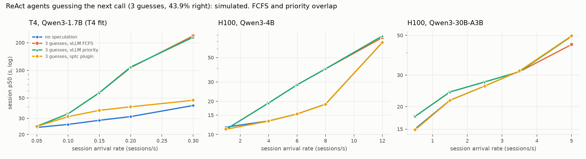
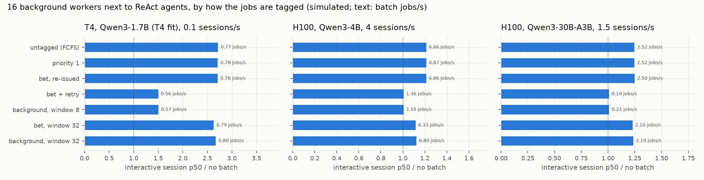

# Bets beyond code-mode sPTC: where a best-effort class matters

**Everything in this file is simulated**, except where a line names a measured source.
It was written before any GPU run of this workload. The quick matrix of
`kaggle/bench_general.py` has since run in the second T4 run
(`results/kaggle_t4_v3/RESULTS.md`, section 7); its outcomes were pre-registered in
`predictions.json` (see the last section).

Why this exists: the census (`results/census/SUMMARY.md`) found that real code-mode agents
make almost no bets. So the question is whether a best-effort request class matters
anywhere. Three workloads where speculative or opportunistic work is common answer it.

## Workloads (sptc_sim/general.py)

| workload | what is speculative | parameters (cited, else assumed) |
|---|---|---|
| **react / action** | ReAct agents. With each step's LLM call, 3 short candidate calls guess the action. A right guess starts the tool when the candidate finishes, hiding it behind the root's decode | SPAgent ([arXiv 2511.20048](https://arxiv.org/html/2511.20048v1)): k=3, candidates "fewer than ten tokens" (8 used), 40% average hit rate, Wikipedia search about 1.5 s per call (p50 1.5 s, p99 6 s assumed) |
| **react / next** | While the tool runs, 1 guess of the *next* step's full LLM call, on a guessed observation. A right guess is kept as that call | hit 27.8% = PASTE v3's top-1 accuracy ([arXiv 2603.18897](https://arxiv.org/html/2603.18897v3)). This is an optimistic stand-in: PASTE predicts tool calls, and guessing the next LLM call also needs the observation right |
| **react / next3** | 3 such guesses | hit 43.9% = PASTE's top-3 recall |
| **branch / literal** | Code-mode programs with literal sub-agent calls in both arms of two `if`s. A literal scanner launches both arms (Pydantic CodeMode `speculate`, pi-fabric; survey section C); the untaken arm is waste | 6 launches per program, 3 used. Output lengths assumed (110-280 tokens) |
| **batch** | 16 closed-loop background workers (evals, summaries) next to interactive ReAct agents (mode none) | 1,500-token prompts, 250-token outputs (assumed) |
| **batchlong** | 48 workers with long jobs, enough KV demand for drops and preemptions | 3,000-token prompts, 1,000-token outputs (assumed) |

ReAct sessions are 6 steps: a 1,200-token system prompt, 120-token steps, 300-token
observations, an 80-token answer. Speculative calls reuse the agent's cached history
(prefix caching), so they prefill only their own tokens but read the whole context.
An action candidate is sent with its root and shares the root's whole prompt, the new
observation included. vLLM 0.32 registers a request's full blocks when it is scheduled,
not when they are computed (`kv_cache_manager.allocate_slots`), so the candidate
prefills only its 60-token suffix plus the prompt's partial last block (60-75 tokens).

An earlier version of this file charged each candidate the 300-token observation again.
That made `action` look far more costly on stock vLLM (for example +129% at h100 8/s,
now +11%) and inflated three pre-registered claims. A review found it. Everything below
is from the corrected model.

## Schedulers

| name | what it models |
|---|---|
| **fcfs** | stock vLLM 0.32. Tags are ignored. `running` stays in admission order and the victim is the newest admitted request (`running.pop()`). A waiting or preempted request is admitted only if its whole sequence (prompt plus output so far) fits in KV: `scheduler_reserve_full_isl`, on by default (`vllm/config/scheduler.py`, `kv_cache_manager.allocate_slots`). This holds for all three schedulers |
| **priority** | stock vLLM `--scheduling-policy priority`, bets at priority 1, everything else 0. Checked against `vllm/v1/core/sched/scheduler.py`: the waiting queue is ordered by (priority, arrival). A running request is preempted only when a running request cannot grow (victim = `max(running, (priority, arrival))`). The waiting loop never preempts. Preempted work is requeued. `running` is never sorted: it stays in admission order, so a running bet takes its share of the step's token budget before a later root. (The first version of this model sorted `running` by priority, which protected roots more than vLLM does) |
| **plugin** | the sptc_vllm plugin as documented in `integrations/README.md`: bets gated *at admission* (no non-bet waiting, `running + 1 <= free_window`, KV reserve 10%), rejected when the gate fails, re-gated at the end of each step, held at most 16 steps. A 512-token prefill allowance per step for bets. Bets are dropped first under KV pressure. No promotion. Running bets are not evicted for waiting work. Plain FCFS otherwise. Free window 8 (T4, H100 4B) or 4 (30B-A3B), per the README's knee guidance |

A refused or dropped bet that turns out to be needed is re-issued untagged (the README's
client rule). A kept guess that makes no progress for 1 s is cancelled and re-issued
untagged. Without that rule, vLLM priority could starve it.

An earlier draft gated bets at submit time, as the simulator's base `Server` does. That
rejected every action candidate, because the candidate arrives together with its root.
The plugin gates inside vLLM's waiting loop, after the root is admitted, and the model now
does the same.

## Setup and sizes

- Configs:
  - t4: Qwen3-1.7B fp16 on a T4. Cost is fitted on the earlier Kaggle T4 run's solo
    calibration (`experiments/t4_validate.fit_cost`), the same fit that predicted the T4
    load rows within 3% median (`results/kaggle_t4/sim_vs_t4.md`).
  - h100: Qwen3-4B on H100 with CUDA graphs.
  - moe: Qwen3-30B-A3B on H100 with CUDA graphs.
- Open-loop Poisson arrivals. Five rates per config for react and branch, chosen by short
  probes so that the top rates are past saturation. 3 seeds, and `max(60, 40 x rate)`
  sessions per run. Every scheduler sees the same arrivals and sessions at a given rate
  and seed.
- Sizes were kept small: 3 seeds, 2-3 rates for batch, and no
  sensitivity sweep over hit rates or free windows. The whole sweep is 954 runs. Their
  per-run times add up to 13 minutes (2 processes).
- Goodput = sessions per second that finish within an SLO of 2x the median latency of
  the same sessions run alone, with no speculation, on stock FCFS.
- Wasted work = tokens the server ran for nothing, as a fraction of all tokens it ran
  (prefill and decode). Two parts, also reported separately in the CSVs:
  - `unused_frac`: every token of a request whose result nobody used (a missed or refused
    guess, a dropped bet, a kept guess that stalled and was re-issued);
  - `redone_frac`: tokens a used request ran twice because it was preempted and
    recomputed.
  Batch jobs cut off when a run ends are neither (`cut_frac`): their result is still
  needed. The first version counted cut jobs as waste and left recompute out.

Points past saturation (h100 rate 12, moe rate 5, t4 rate 0.3, the top branch rates) do
not reach a steady state with this many sessions. Read them as "overloaded", not as
exact numbers.

Files:
- `react_*.csv`, `branch_*.csv`, `batch_*.csv`, `batchlong_*.csv`: one row per run.
- `summary.csv`: mean over seeds, with the min and max of the session p50.
- `verdict.csv`: the plugin against FCFS and against no speculation.
- `tables.md`: every cell.
- Figures: `fig_general_react.png` and `fig_general_batch.png`.

Rerun with `python experiments/general.py --workload react --config t4 --procs 2`. Then
`--report` writes the tables and figures, and `--kaggle-predict` writes the predictions.

## 1. ReAct agents with prediction-based speculation



Session p50 (s) / root TPOT p99 (ms) / wasted work, mean of 3 seeds. The rows are loads
where speculation on stock vLLM is already costly, at least with next-call guesses:

| config, rate | no speculation | next3, FCFS | next3, priority | next3, plugin | action, FCFS | action, plugin |
|---|---|---|---|---|---|---|
| t4, 0.15/s | 28.6 / 44 / 0% | 57.0 / 148 / 50% | 57.2 / 136 / 50% | **36.7 / 62 / 43%** | 29.8 / 67 / 21% | 29.2 / 48 / 16% |
| h100, 6/s | 15.4 / 13 / 0% | 28.3 / 44 / 56% | 28.3 / 44 / 56% | **15.4 / 13 / 2%** | 15.4 / 19 / 21% | 15.4 / 13 / 1% |
| moe, 0.5/s | 15.0 / 15 / 0% | 17.7 / 24 / 59% | 17.7 / 24 / 59% | **14.9 / 15 / 25%** | 13.5 / 17 / 21% | 14.4 / 14 / 7% |

**Full-size guesses (`next`, `next3`) are where the class matters.** Action candidates
are 60-75 prefill tokens and 8 output tokens each. They cost stock vLLM little: between
-10% and +16% of session p50 below the top rate of each ladder (`verdict.csv`,
`spec_fcfs_vs_none`). Next-call guesses are as big as the real call.

**Where the plugin helps.** It helps wherever wasted guesses would slow the agents down.
- On the H100 4B config, at rates 4-8, stock FCFS with next-call guesses is slower than
  no speculation by 3-32% (`next`) and 46-109% (`next3`). The plugin brings every mode to
  within 1% of no speculation, with goodput within 1% of no speculation. Wasted work
  falls from 20-58% of tokens (FCFS, all three modes) to 0.3-5%.
- On the T4 it beats stock FCFS by 7-80% with `next3` from 0.1/s, and by 4-34% with
  `next` or `action` from 0.2/s. Below that it matches FCFS within about 2%.

**Where the plugin does nothing.**
- At light load (h100 1/s, t4 0.05/s) there is spare capacity, so it admits nearly every
  bet and matches FCFS within 0.5%. Speculation then pays off a little: `next` saves 5%
  of session time on both H100 and T4, `action` 6-8%. That is small, because a right
  guess saves only one step's decode or tool wait. With `next3` the T4 is already 3%
  slower than no speculation at 0.05/s.
- vLLM priority does nothing: within ±0.3% of FCFS on every ReAct and branch cell
  except the top rate of each ladder and t4 next3 at 0.2/s (+1.5%), where stock FCFS is
  already overloaded by the speculation (`tables.md`). Low priority only orders the
  waiting queue and picks the preemption victim. Once a bet runs, it decodes in the same
  batch and slows every step, and the waiting loop never preempts it. Even at the top
  rates the effect is mixed: -8% to +11% against FCFS.

**Where the plugin hurts, or does not fully protect.**
- *T4: still slower than no speculation.* With `next3` at every rate: +3% at 0.05/s,
  +22% at 0.1/s, +28% at 0.15-0.2/s, +14% at 0.3/s. With `next` by 5-12% and with
  `action` by 2-5%, from 0.15/s. On this config a window of 8 sequences is not "spare".
  Each extra sequence costs 0.44 ms per step (fitted from the measured `concur.json`).
  A guess's 300-token prefill over a 2-4k context is expensive on a T4 (fitted attention
  efficiency 0.013). The free window should be smaller on small GPUs. That was not swept
  here.
- *Where action candidates already help on stock vLLM* (MoE at 0.5-3.5/s, saving 5-10%;
  H100 at 1-4/s, saving 8%), the plugin rejects most of them (878 of 900 on MoE at
  1.5/s, window 4) and gives the saving back: +5-9% against FCFS on MoE, +7% on H100 at
  4/s.
- *No light-load TPOT cost from bets in the model.* At t4 0.05/s, root TPOT p50 with
  action candidates is 18.8 ms under both FCFS and the plugin (`summary.csv`). The first
  version predicted a gap here (23.4 vs 20.2 ms), but only because of the observation
  prefill it wrongly charged to candidates. So the simulator offers no bet-related cause
  for the light-load gap the earlier T4 run measured at 1 agent (plugin root TPOT 19.5 ms
  vs 16.8 ms, `results/kaggle_t4/RESULTS.md`). That run tagged spec-ptc's calls `early`.
  RESULTS.md first suspected the early-prefill allowance; `results/t4_run1_analysis/root_cause.md` has
  since ruled it out, and the cause is open. This benchmark sends no `early` tags, so it
  does not test that gap (see the notes on claims 11 and 12).
  With `next3`, whose guesses do carry a 300-token prefill, the plugin's root TPOT
  p50 at 0.05/s is 23.7 ms against 22.2 ms on FCFS (+7%).

## 2. Branch-arm literal launches (code mode)

Session p50 (s), mean of 3 seeds:

| config, rate | no speculation | literal, FCFS | literal, priority | literal, plugin |
|---|---|---|---|---|
| t4, 0.05/s | 44.9 | 34.5 | 34.5 | 35.4 |
| t4, 0.1/s | 60.6 | 48.6 | 48.6 | 58.9 |
| h100, 1/s | 10.3 | 7.8 | 7.8 | 10.2 |
| moe, 0.25/s | 20.4 | 19.6 | 19.6 | 20.9 |

**Here the bet class is the wrong tool.** Launching both arms costs little: about 7% of
tokens are wasted, because arm prompts are short literals. It saves 4-26% on stock vLLM
below saturation. The plugin rejects arms whenever other work is waiting. A rejected arm
that is needed is re-issued only after the condition is known, which serializes it again.
So the plugin is 6-31% slower than FCFS at every rate below the top on H100 and MoE,
and on the T4 from 0.1/s. It does lower root TPOT p99 by 3-29%.

A 50/50 arm with a short prompt is closer to "early" (likely used) than to "bet". The
plugin's `early` class (normal admission, prefill allowance only) is the better tag for
it. This was not simulated here.

## 3. Background batch work: which class?



16 workers next to interactive ReAct agents (`batch_*.csv`):

- Untagged FCFS, priority 1, and "bet re-issued as normal" are the same.
  - Interactive p50 rises 2.7x on the T4, 1.2x on H100 4B and 1.25x on MoE (middle rate).
  - Priority 1 is within 1% of FCFS everywhere: the jobs take decode slots either way.
  - The README's re-issue rule turns every refused job into normal work.
- Gated admission protects the agents. Bets with retry and the simulated background
  class with window 8 give the agents the same latency (within about 1%):
  - H100: interactive p50 within 1% of no batch at 4-8/s (+4% at 1/s), at 16-49% of
    FCFS's batch throughput.
  - MoE: within 1% at 1.5-2.5/s (+13% at 0.5/s), at 6-27% of the throughput.
  - T4: 1.4-1.55x no batch, because the window is again too wide there.
  The bet variant pays for this with 4,800-11,300 rejected requests per T4 run (1 s
  back-off). The background class has none.
- A window of 32 gets 55-108% of FCFS's batch throughput: 103% on the T4, 84-108% at
  the lower two rates on H100 and MoE, but only 55-66% at their top rates. Interactive
  p50 is 1.0-2.7x no batch. So what counts as "spare capacity" for background work is a
  real knob, separate from the bet window.

Long jobs with KV pressure (`batchlong_*.csv`, 48 workers):

| config, rate | untagged FCFS | priority 1 | bet, window 8 | background, window 8 | bet, window 32 | background, window 32 |
|---|---|---|---|---|---|---|
| t4, 0.05/s: interactive p50 (s) | 1173 | 126 | 40.9 | 40.6 | 78.6 | 79.9 |
| batch jobs/s | 0.164 | 0.130 | 0.156 | 0.155 | 0.188 | 0.185 |
| refused / dropped / preempted | 0 / 0 / 165 | 0 / 0 / 95 | 50444 / 0 / 0 | 0 / 0 / 0 | 31638 / 17 / 17 | 0 / 0 / 38 |
| wasted work: unused + redone | 0 + 14% | 0 + 15% | 0 | 0 | 4% + 0 | 0 + 8% |
| moe, 1.5/s: interactive p50 (s) | 108.4 | 34.4 | 22.3 | 22.4 | 28.1 | 28.4 |
| batch jobs/s | 1.01 | 0.75 | 0.060 | 0.070 | 0.46 | 0.53 |

No speculation and no batch at these rates gives 23.9 s (t4) and 21.7 s (moe).

- Untagged long jobs swamp the agents: interactive p50 is 1,170-1,290 s on the T4,
  against 41-43 s with gated bets or background work at window 8. The T4 sees 129-165
  recompute preemptions per run, and 13-14% of all tokens are recomputed. On batch
  throughput FCFS wins: 0.15-0.16 jobs/s on the T4 against 0.13-0.16 for bets at
  window 8, and 1.0 against 0.06 on MoE at 1.5/s. Gating buys the agents' latency with
  batch throughput.
- Priority 1 helps (126-176 s on the T4), and its jobs become the preemption victims
  (11-15% of all tokens recomputed). It stays 1.35-4.1x worse than gated admission on
  interactive p50 (MoE 2.5/s: 35.8 vs 26.5 s; T4 0.1/s: 176 vs 42.7 s).
- *Correction.* The first version of these rows admitted a waiting request on its first
  chunk only. vLLM 0.32 also requires the whole sequence to fit
  (`scheduler_reserve_full_isl`, default True). A review found it. Without the rule the
  T4 rows thrashed: FCFS p50 over 2,200 s with 66% of tokens recomputed and fewer batch
  jobs/s than bets (0.082), and priority about 9-10x worse than gating. With it, FCFS
  gets more batch throughput than bets on the T4, and priority is 3.1-4.1x worse there.
  H100 and MoE rows, and the bet and background rows, barely moved (interactive p50
  within 5%).
- Wasted work does not favor requeue over drop. With a wide window, bets do get
  dropped (17-18 per T4 run, under 1 on average on MoE at 2.5/s). A dropped bet's
  progress is lost (4-6% of tokens on the T4). The background class instead recomputes
  requeued jobs, and that redone work is larger: 8-17% on the T4 at the same window,
  after 38-61 preemptions per run. It is preempted more often partly because the simulated class can
  also be evicted for waiting work (`evict_bg_for_waiting=True`), which bets are not.
- The batch-throughput gap between bets and background is not about drops. At
  window 8 nothing is dropped on either side, yet the background class gets up to 37%
  more batch throughput (H100 batch 4/s: 1.55 vs 1.36 jobs/s; batchlong H100 4/s: 0.38 vs
  0.29). The same holds on MoE at 1.5/s, window 32 (0.53 vs 0.46, zero drops). The gap
  comes from queueing versus polling: a refused bet waits out the client's 1 s back-off,
  an assumed value, while a queued background job starts the moment capacity frees.
  The eviction privilege above may also add to it.

**Decision: a distinct background class is still the better fit, and it is not
implemented.** Bet semantics fit speculation (drop, reject, never wait) and do not fit
work that is always needed. The reasons that hold up in this simulation are queueing
(no reject-and-retry churn: tens of thousands of rejections per long-job run, and
capacity left idle between retries) and the re-issue rule, which turns refused jobs into
normal work. Lost progress is not one of them: requeue redid more work than drop here.
vLLM priority has the right queueing semantics but no spare-capacity gate. The simulated
class is a model, not the plugin: it
is the bet gate with requeue instead of drop, and eviction for waiting work, which the
vLLM hooks cannot do.

## 4. The Kaggle run (workload a, plus one batch cell)

`kaggle/bench_general.py` drives real vLLM 0.32 on the T4 with the same arms:
- `fcfs`: stock;
- `priority`: `--scheduling-policy priority`, bets at `"priority": 1`;
- `plugin`: `--scheduler-cls sptc_vllm.scheduler.SptcScheduler`, bets tagged
  `vllm_xargs={"sptc_class": "bet"}`, free window 8.

Mechanics follow `kaggle/vllm_bench.py`:
- raw streamed completions with `ignore_eos`, so lengths are fixed;
- the same `vllm serve` flags as `sptc_kaggle.ipynb`;
- session plans (output lengths, tool sleeps, which guesses are right) are drawn by the
  simulator's own `react_plan`, so the predictions simulate the same sessions.

It was tested only against a small fake streaming server (`tests/test_bench_general.py`).

**Update.** These cells are now C2 (quick) and C4 (full) of
`kaggle/sptc_kaggle_v3.ipynb`, with outputs in `general_quick/` and `general_full/`; the
server flags come from `vllm_bench.py`'s `SERVERS` (stock and priority carry the
plugin-fixed `--additional-config`, so all three share one compiled artifact), and the
fake server is `kaggle/fake_openai_server.py`. The claims below are scored by
`experiments/prereg_compare.py` from the copy in `results/prereg_v2/` (identical cells).

The notebook cell as first written. It runs after the other cells: it starts and stops
its own servers on port 8000.

```python
GEN = f"python {SIM}/kaggle/bench_general.py"
!{GEN} estimate --quick
!{GEN} matrix --model {MODEL} --out {OUT} --quick      # ~25 GPU-min: none,next3 x 8 agents x 3 arms
# full: ~110 GPU-min: none,action,next,next3 x 1,4,8,16 agents + a 16-worker batch cell, x 3 arms
# !{GEN} matrix --model {MODEL} --out {OUT}
```

The estimates are the simulator's predicted session times plus about 4 minutes of
server start per arm (12 of the quick run's 25 minutes). The quick matrix runs 6 of the
full matrix's cells with the same sessions, so claims 1, 3 and 5 below apply to it
unchanged (`quick_claims` in `predictions.json`). Those are the claims where the
simulator predicts the biggest difference between arms. The full run is needed for the
rest. (The first quick matrix, none/next at 1 and 8 agents with 2 sessions, was
predicted to show no difference between arms at all, so it could not test the plugin.)

**Pre-registered predictions** (`predictions.json`, written 2026-10-20T01:51Z at
dd02f46, before any run of this benchmark). Its numbers are those of the revision
written at 2026-10-20T01:22Z (7262b86): adding full-sequence admission to the model
changed no cell, and only the text of claims 11 and 12 was reworded since. That revision
replaced a first version
(2026-10-20T00:44Z, 65dac71), also made before any run. The first version had the
action-candidate prefill error above, which alone made claims 2, 6 and 11 predicted to
pass (ratios 1.74, 0.68 and 1.16). With the error fixed, they are 1.13, 0.92 and 1.00.
Claims 2 and 6 got new bounds from the new predictions by the same rule as the others.
Claim 11 was restated, claim 12 added, and claim 8's text narrowed. The reasons are
recorded under `revision` in the file.
- Calibration: the earlier T4 run's solo measurements and its client overhead. Nothing
  was fitted on this workload.
- Expected error: the same fit had 3% (session p50) and 5% (root TPOT p50) median error
  on the earlier T4 load rows, max 16-17%.
- The bounds below leave room for that error.

| # | claim (8 agents unless noted) | predicted ratio | pass if |
|---|---|---|---|
| 1 | stock vLLM: next3 session p50 / none | 1.63 | >= 1.3 |
| 2 | stock vLLM: action / none | 1.13 | >= 1.05 |
| 3 | priority / FCFS, next3 | 1.00 | 0.9-1.1 |
| 4 | priority / FCFS, action | 1.00 | 0.9-1.1 |
| 5 | plugin / FCFS, next3 | 0.71 | <= 0.8 |
| 6 | plugin / FCFS, action | 0.92 | <= 0.97 |
| 7 | 16 agents: plugin next3 / plugin none | 1.00 | 0.9-1.1 |
| 8 | 1 agent: plugin next / plugin none, on these 3 sessions | 0.81 | <= 0.9 |
| 9 | batch cell: plugin (bets) / FCFS (untagged), interactive p50 | 0.59 | <= 0.75 |
| 10 | batch cell: priority 1 / FCFS | 0.98 | 0.9-1.1 |
| 11 | 1 agent, action: plugin root TPOT p50 / FCFS | 1.00 | 0.95-1.05 |
| 12 | 1 agent, none: plugin root TPOT p50 / FCFS | 1.00 | 0.95-1.05 |

Notes on the claims:
- Claim 8 is a property of the 3 sessions the 1-agent cell runs (agent 0, sessions 0-2),
  not of light load in general. In them 6 of 15 `next` guesses are right, against the
  27.8% average. Over the ladder, `next` saves only about 5% at light load (section 1).
  The bench draws the same plan, so the comparison with the simulator is still fair. The
  1-agent `action` cell is likewise lucky (9 of 15 right, against 40%). The 4-, 8- and
  16-agent cells are within 7 points of the nominal hit rates.
- Claims 6 and 2 predict a small effect (8% and 13%), close to the fit's error. A miss
  on them says less than a miss on 1, 5 or 9.
- Claims 11 and 12 do not test light-load gap (1). That gap (root TPOT 19.5 vs 16.8 ms)
  was measured with spec-ptc's calls tagged `early`, and RESULTS.md blames the
  early-prefill allowance. This bench sends only `bet` tags, and an action candidate
  prefills 60-75 tokens, well under the 512-token allowance. So neither claim exercises
  that mechanism. If both pass, gap (1) is still unexplained.
- Claim 12 is mostly a repeat of a measured row. In the earlier T4 run, untagged traffic
  at 1 agent had root TPOT p50 16.2 ms under the plugin and 15.7 ms on stock vLLM
  (ratio 1.03, inside the bound; `results/kaggle_t4/sim_vs_t4.md`). It should pass. A
  failure would point at plugin overhead on untagged traffic, which that row did not show.
- Claim 11 has no measured counterpart. It checks that short bets cost nothing at 1
  agent, as the simulator predicts.

Absolute predicted values for every cell (session p50/p99/mean, root TPOT p50/p99,
bets, rejections, wasted tokens, batch jobs/s) are in `predictions.json` under
`cells` (full run) and `quick_cells` (the subset the quick run measures).

## Limits

- All results are simulated. The T4 cost model is calibrated, but only on stock-vLLM
  solo measurements. H100 and MoE use the report's roofline configs, which have no
  measured load validation for these workloads.
- Hit rates are cited, but not for this setting. SPAgent's 40% is for multi-hop QA.
  PASTE's 27.8% / 43.9% are for tool calls, used here as a stand-in for guessing a full
  LLM call. Hits are i.i.d. per step. SPAgent reports 73% in the first step, falling to
  11% later.
- The plugin model is close, not exact:
  - the free window is a sequence count, as in the plugin;
  - vLLM's async scheduling, CUDA-graph padding and the hold limit's step counting are
    not modeled;
  - shared prefixes are assumed cached (never evicted while a guess runs).
- Sizes are small (3 seeds, 60-480 sessions per run, a 5-point ladder). Seed spread
  is in `summary.csv` (`lat_p50_min` / `lat_p50_max`). The min-max spread is under 5% of
  the mean in only 37% of cells. Treat differences of a few percent, such as the 5%
  light-load gains, as within noise.
- Not explored: free-window and allowance tuning per GPU, which the T4 rows argue
  for; the `early` tag for branch arms; hit-rate sensitivity.
